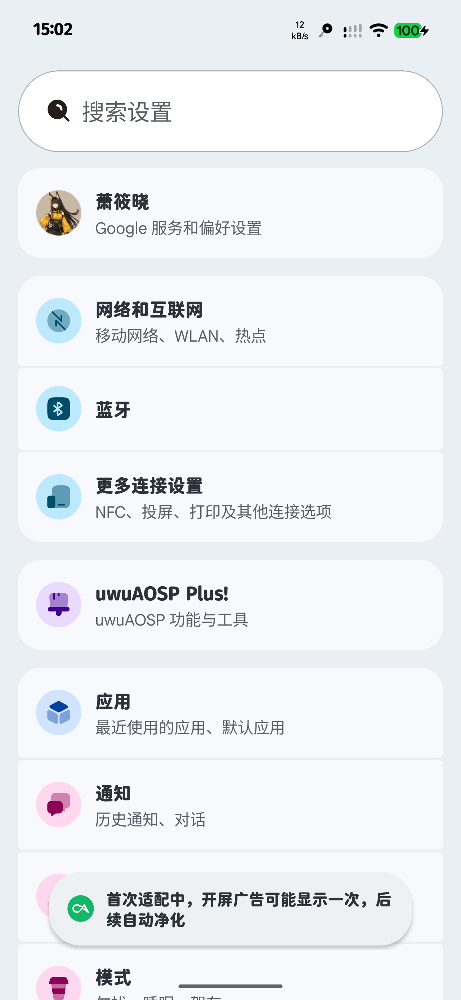
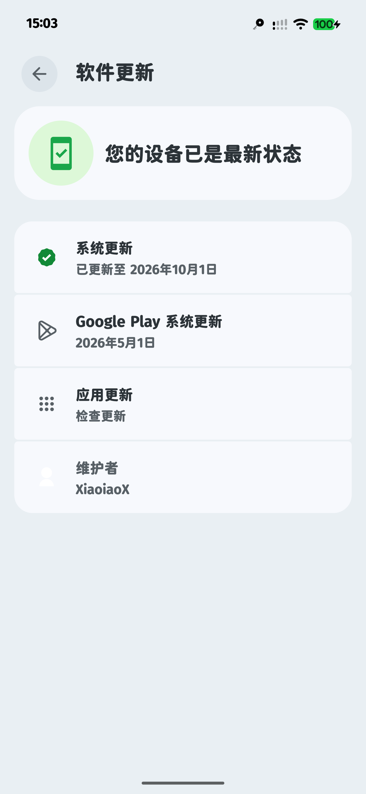

  

  <h1>uwuAOSP 17.140</h1>
  <h3>Android 17 | GMS Included</h3>

  
A custom Android ROM with a personalized Android experience.

  

    <a href="#about">About</a> •
    <a href="#downloads">Downloads</a> •
    <a href="#changelog">Changelog</a> •
    <a href="#screenshots">Screenshots</a> •
    <a href="#important-notes">Important Notes</a>
  

---

## About

**uwuAOSP 17.140** is a custom Android 17 ROM with Google Mobile Services (GMS) included.

- [Official Website](https://uwuaosp.uwuniverse.org/)
- [Video Introduction](https://www.bilibili.com/video/BV1XFjo64Ekk/)

---

## Downloads

| Mirror | Link |
|:---|:---|
| Google Drive | [Download ROM](https://drive.google.com/drive/folders/1Rr94RYUYjAcKNMNzCGrbwcss3qG8tXxK?usp=sharing) |
| 123 Cloud Drive | [Download ROM](https://1851700817.share.123pan.cn/123pan/1VWBvd-ndir?pwd=CRFz#) |

---

## Changelog

### Initial Release

- First build of uwuAOSP 17.140.
- Added a custom boot animation. [Preview](#boot-animation)
- Adjusted SELinux policies to improve compatibility with certain security checks.

---

## Important Notes

> [!CAUTION]
> **Back up your data before flashing!**
>
> A clean installation requires formatting user data.
> All apps, settings, and files in internal storage will be erased.

- Ensure your bootloader is unlocked.
- Verify that the ROM is compatible with your device.
- Follow the correct installation instructions.
- Do not relock the bootloader while running an unsupported custom ROM.

---

## Screenshots

<b>Floating Window</b>

  

<b>Quick Settings</b>

  

<b>System Interface</b>

  
  
  

<b>ROM Information</b>

  

---

## Boot Animation

  

  <i>Custom boot animation for uwuAOSP 17.140</i>

---

  Made with ❤️ for the Android community.

